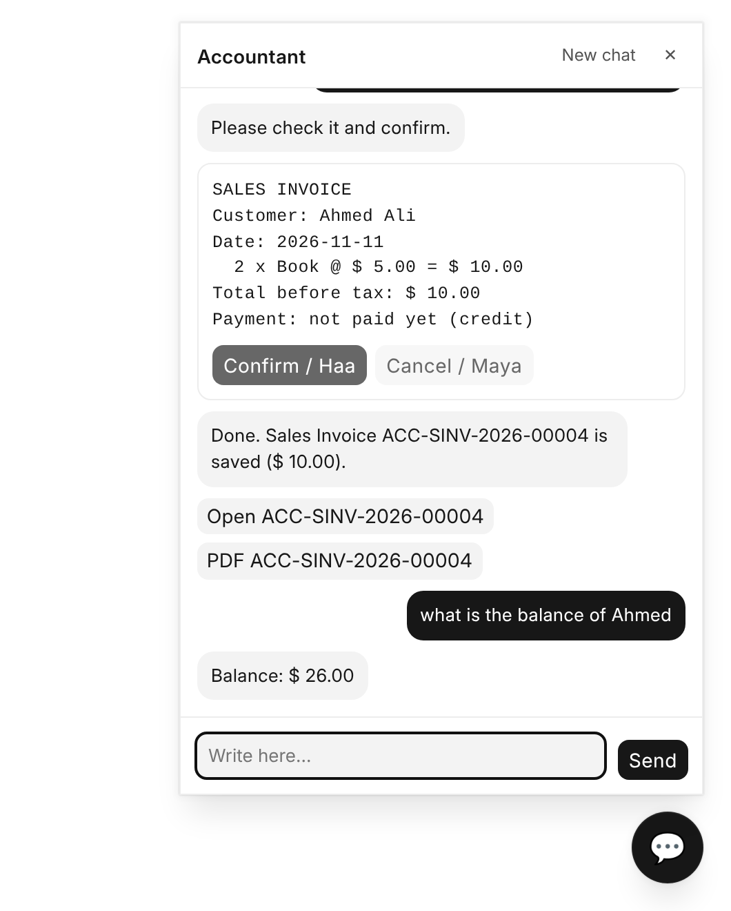

# XAL Accountant Bot

A chatbot inside ERPNext that works like an accountant. A manager writes what happened in
plain English or Somali ("I sold 2 books to Ahmed for 5 dollars each"), the bot prepares the
document, shows it, and saves it only after Confirm.



- **`HANDOFF.md`** - the plan, every decision, what is built and what is not. Read this first.
- **`docs/TESTING.md`** - what was tested, what was not, and how to repeat the tests.

It is a Frappe app (`xal_chatbot`) for ERPNext v16. The Docker stack it runs on is in
[`aliiherzi/erpnext-system`](https://github.com/aliiherzi/erpnext-system).

## What it does (version 0.1)

| You write | The bot |
|---|---|
| "I sold 2 books to Ahmed for $5 each" | Prepares a sales invoice, shows it, saves it on Confirm, gives Open and PDF buttons |
| "... and he paid cash" | Also records the payment against that invoice |
| "Ahmed paid me 4 dollars" | Prepares a payment that settles his oldest unpaid invoices first |
| "How much does Ahmed owe?" | Balance and unpaid invoices |
| "Who owes me money?" | Receivables, by customer |
| "Profit and loss this month" | Income, expenses, net profit |
| "Send me the PDF of ACC-SINV-2026-00012" | A PDF button |

Purchases, journal entries, the Balance Sheet, Excel and WhatsApp are not built yet (see `HANDOFF.md`).

## Continue on another computer

```bash
git clone https://github.com/aliiherzi/ErpNext-For-chat-BOT.git
```

Everything is in the repository: code, plan, decisions and tests. Passwords and API keys are
never in it; they are typed into ERPNext on each installation.

## Try it without installing

A throw-away demo with test data runs in GitHub Codespaces or on any PC with Docker:
see **`docs/DEMO.md`**.

## Install

Try it on a demo or test site first. Make a backup before installing on a site with real books.

**1. Build an image with the bot** (from the root of this repository). `BASE` is the image your
stack runs now; in `erpnext-system` that is `erpnext-rays:v16.52.0`.

```bash
docker build -f docker/chatbot.Containerfile --build-arg BASE=erpnext-rays:v16.52.0 -t erpnext-rays-chatbot:v16.52.0 .
```

**2. Use that image.** Back up `frappe_docker/pwd.yml`, replace `erpnext-rays:v16.52.0` with
`erpnext-rays-chatbot:v16.52.0` on every service, then:

```bash
docker compose -p erpnext -f pwd.yml up -d
```

**3. Install the app on the site** (once per site):

```bash
docker compose -p erpnext -f pwd.yml exec backend bench --site frontend install-app xal_chatbot
```

**4. Set it up in ERPNext** as Administrator:

1. Open **Chatbot Settings**: tick Enabled, choose the provider and model, type the API key,
   choose the company and (if you want) the customer to use when none is named.
2. Give the role **Accountant Bot User** to each user who should see the chat. The role only
   opens the chat; what the bot can do for a user comes from their normal ERPNext roles.
3. Each payment method the bot should use (Cash, EVC Plus, bank...) needs an account for the
   company in **Mode of Payment**.
4. Log in as that user: the chat button is at the bottom right.

### The brain

| Provider | Base URL | Model | Notes |
|---|---|---|---|
| OpenAI-compatible | `https://openrouter.ai/api/v1` | `google/gemma-4-26b-a4b-it:free` | Free, for testing. Daily limits; prompts may be kept by the provider. |
| Claude | (not used) | `claude-haiku-5-5` | For real books. Paid per use. |
| OpenAI-compatible | `http://your-server:11434/v1` | your model | A model you host yourself (Ollama etc.). |

## Layout

```
xal_chatbot/
  api.py            what the chat box calls: send, confirm, cancel, reset
  tools.py          what the AI may do (look-ups, and "prepare" which saves nothing)
  actions.py        saving after Confirm
  brain/            the replaceable AI: openai_compatible.py, claude.py, the instructions
  public/           the chat box (js, css)
  xal_chatbot/doctype/   Chatbot Settings, Chatbot Action, Chatbot Log
docker/chatbot.Containerfile
dev/                the demo (start-demo.sh, compose.yml), test data, a scripted stand-in AI, the test flows
.devcontainer/      starts the demo in GitHub Codespaces
```
